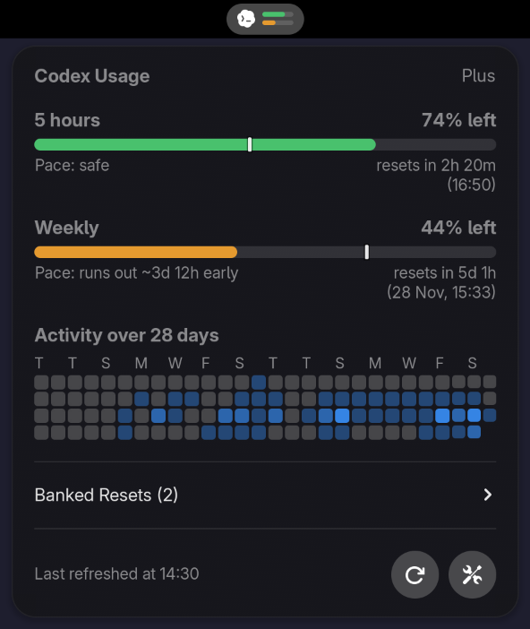

<div align="center">
  <h1>Codex Meter</h1>
  <p>Codex usage limits and resets from your GNOME panel.</p>
  <p>
    <a href="https://extensions.gnome.org/extension/9993/codex-meter/"></a>
    <a href="https://extensions.gnome.org/extension/9993/codex-meter/"></a>
    <a href="#requirements"></a>
    <a href="https://github.com/slobbe/codex-meter/blob/main/LICENSE"></a>
    <a href="https://github.com/slobbe/codex-meter/actions/workflows/ci.yml"></a>
  </p>
</div>
<p align="center">
  
</p>

A GNOME Shell extension that shows your Codex usage limits, resets, and usage trends from the panel.

## Features

- **Usage limits**: Track remaining or used quota for your Codex usage windows.
- **Usage pace**: See usage trends and estimates of whether your quota will last until it resets.
- **Banked resets**: Redeem individual resets or enable automatic redemption before expiry or when quota runs low.
- **Display options**: Choose between percentages, bars or circular progress indicators.
- **Notifications**: Get alerts when a usage window runs low, is exhausted, or resets after exhaustion.

    The **Usage notifications** switch controls all three alert types. A reset alert requires a window previously observed at 100% usage or more. Its scheduled reset time must pass. A successful usage refresh must then show a later reset time in the future and usage below 100%. Banked resets do not trigger reset alerts. Each alert applies to one window, not the whole account. Turning off usage notifications removes queued usage alerts. Turning off notifications or disabling the extension clears notification state.

## Requirements

- GNOME Shell 45–51.
- [Codex CLI](https://developers.openai.com/codex/cli) or the [ChatGPT desktop app](https://chatgpt.com/download/), signed in with your ChatGPT account on the same machine.

## Install

### GNOME Extensions

Codex Meter is available from [GNOME Extensions](https://extensions.gnome.org/extension/9993/codex-meter/).

### Manual installation

Alternatively, install from a GitHub release:

1. Download the zip from the [latest release](https://github.com/slobbe/codex-meter/releases/latest).
2. Install and enable the extension with:

```sh
gnome-extensions install --force codex-meter@slobbe.github.io-<version>.zip
gnome-extensions enable codex-meter@slobbe.github.io
```

If GNOME does not pick it up immediately, log out and back in.

## Credentials file

By default, Codex Meter reads `~/.codex/auth.json`. To use a different local credentials file, open **Preferences → Credentials → Browse…** and select the JSON file. Use the reset button to restore the default path.

The extension never modifies the credentials file. It keeps usage history separate for each account and credentials-file path. It shows a cached snapshot only when it matches the selected account. If the credentials do not identify an account, the extension keeps usage data in memory only. Older cache and history files with no account information stay on disk, but the extension no longer uses them.

## Uninstall

To uninstall:

```sh
gnome-extensions uninstall codex-meter@slobbe.github.io
```

## Troubleshooting

- **Extension not showing:** check that it is enabled, then log out and back in.
- **Usage not loading or authentication expired:** sign back in through the ChatGPT desktop app or Codex CLI, and check your internet connection.
- **Still stuck:** [open an issue](https://github.com/slobbe/codex-meter/issues) with your GNOME Shell version and the error message. Never share your auth file or tokens.

## Limitations

Codex Meter relies on ChatGPT backend endpoints, so upstream changes may affect functionality.

## Privacy

Codex Meter reads credentials from the file selected in Preferences (default `~/.codex/auth.json`) to request usage and banked reset data from ChatGPT. It does not store credentials or send them anywhere else.

Codex Meter caches usage data in `~/.cache/codex-meter` and `~/.local/state/codex-meter`. It uses up to 30 days of usage history, with a limit of 25,000 entries. It removes older entries from disk in batches.

## License

[GPL-3.0-or-later](LICENSE)

## Disclaimer

This extension is not affiliated with or endorsed by OpenAI.
